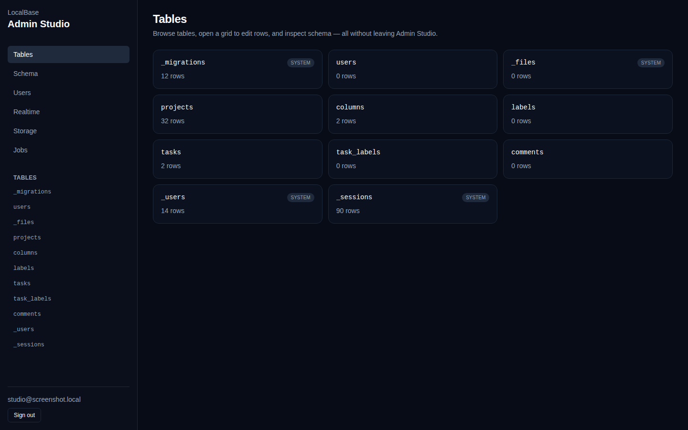

# LocalBase

Local-first backend platform. Define a schema, get a running API, query it with an SDK.

[](LOCALBASE-MVP.md)
[](LOCALBASE-POST-MVP.md)
[](LAUNCH.md)
[](CHANGELOG.md)

**Developer preview.** LocalBase is a single-process SQLite backend for local
development, prototypes, and small internal tools — not a multi-instance
production platform. See [Operational limits](#operational-limits-developer-preview).

Full documentation: **[docs/](docs/README.md)**.

---

## Purpose

LocalBase turns a TypeScript schema (`localbase.config.ts`) into a local backend:
SQLite migrations, a generated REST API, optional JWT auth with owner policies,
WebSocket realtime, local-disk Storage, scheduled Jobs, and an embedded Admin
Studio — all in one Node.js process. No Docker or cloud account required.

---

## Features

- **SQLite** with additive auto-migrations from `localbase.config.ts`
- **REST API** generated from your tables (`/api/:table`)
- **TypeScript SDK** — query builder, auth, realtime, Storage (`@localbase/sdk`)
- **Admin Studio** at `/admin/` — tables, schema, users, Storage, Jobs
- **Realtime** — `db.subscribe(...)` over WebSockets
- **Scheduled jobs** — cron TypeScript handlers with run history
- **Default-on auth** — JWT sessions, Argon2id passwords, refresh-token rotation
- **Owner policies (RLS)** — public API scoped to the signed-in user
- **Local file Storage** — private buckets and signed URLs
- **Hot-reload** when the config file changes
- **CLI** — `init`, `dev` / `studio`, `db`, `auth`, `admin`, `jobs`

---

## Stack

| Layer | Technology |
| --- | --- |
| Language | TypeScript (Node.js `>=22`) |
| HTTP | [Hono](https://hono.dev/) + `@hono/node-server` |
| Database | SQLite via [`better-sqlite3`](https://github.com/WiseLibs/better-sqlite3) |
| Auth | [jose](https://github.com/panva/jose) (JWT) + `@node-rs/argon2` |
| Realtime | `ws` WebSockets |
| Jobs | [croner](https://github.com/Hexagon/croner) |
| Config load | [jiti](https://github.com/unjs/jiti) (TS config without a build step) |
| Admin UI | React 19, Vite, Tailwind, TanStack Query/Table |
| Monorepo | npm workspaces |

Publishable packages (shared version `0.1.0-beta.1`): `@localbase/shared`,
`@localbase/core`, `@localbase/sdk`, `@localbase/cli`. Private: `@localbase/admin`,
`@localbase/e2e`, `@localbase/landing`, examples.

---

## Prerequisites

- **Node.js `>=22`** (see `.nvmrc`; CI also tests Node 24)
- **npm** (lockfile is `package-lock.json`; prefer `npm ci` when developing this repo)

No Docker, PostgreSQL, or external services are required for the default local workflow.

---

## Quickstart (consume the CLI)

```bash
# Scaffold a new project (package: @localbase/cli; binary name: localbase)
npx @localbase/cli init

# Start the dev server and open Admin Studio
npx @localbase/cli studio
```

REST API at `http://localhost:5180`, Admin Studio at
`http://localhost:5180/admin/`.

> **CLI package vs binary:** run `npx @localbase/cli …`. After installing
> `@localbase/cli` (global or as a project dependency), use `localbase`.
> There is no npm package named `localbase`. `init` scaffolds the **current
> directory only** (no `init <path>`).

Useful commands after init:

```bash
localbase dev                 # API + realtime + jobs + Studio (no browser open)
localbase studio              # same as dev, opens the browser
localbase db migrate          # apply pending CREATE TABLE / ADD COLUMN
localbase db reset            # drop user tables and re-migrate (keeps system tables)
localbase db backup [out]     # online backup of SQLite + storage
localbase db restore <dir>    # restore (stop the server first)
```

Walkthrough: [docs/GETTING-STARTED.md](docs/GETTING-STARTED.md). CLI reference:
[docs/CLI.md](docs/CLI.md).

---

## Define your schema

Edit `localbase.config.ts`:

```ts
export default {
  auth: {
    enabled: true,
    jwtSecret: process.env.JWT_SECRET ?? "replace-with-a-long-random-secret",
  },
  tables: {
    users: {
      id: { type: "integer", primaryKey: true, autoIncrement: true },
      name: { type: "text", nullable: false },
      email: { type: "text", unique: true },
      created_at: { type: "text", default: "CURRENT_TIMESTAMP" },
    },
    posts: {
      id: { type: "integer", primaryKey: true, autoIncrement: true },
      title: { type: "text", nullable: false },
      body: { type: "text" },
      user_id: { type: "integer", references: { table: "users", column: "id" } },
    },
  },
};
```

`localbase init` generates the fallback secret for you. Auth is enabled when
the section is omitted too, but then the server uses a new random secret on
each start; set `auth.enabled: false` to opt out explicitly. Save the file —
the dev server hot-reloads. Full config (auth, policies, Storage, Jobs, CORS):
[docs/CONFIG.md](docs/CONFIG.md).



`localbase studio` opens Admin Studio at `/admin/`. [docs/ADMIN.md](docs/ADMIN.md).

```ts
import { createClient } from "@localbase/sdk";

const db = createClient("http://localhost:5180");
const { data, error } = await db.from("posts").select("*");
```

---

## Environment variables

LocalBase reads most settings from `localbase.config.ts`. These env vars are
commonly used alongside config:

| Variable | Purpose |
| --- | --- |
| `JWT_SECRET` | Typical pattern for `auth.jwtSecret` in config |
| `STORAGE_SECRET` | Optional Storage signing secret (`storage.secret`); falls back to `auth.jwtSecret` |
| `LOCALBASE_DATA_DIR` | Override the data directory (default: `<cwd>/.localbase/`) |
| `AUTH_EMAIL` / `AUTH_PASSWORD` | Credentials for `localbase auth create-user` / `reset-password` (keeps secrets out of shell history) |

Default data layout under `.localbase/`: `data.db` and `storage/`.

---

## Repository structure

npm workspaces monorepo:

```
localbase/
  packages/
    shared/     # @localbase/shared — types, schema helpers
    core/       # @localbase/core — SQLite, REST, auth, realtime, Storage, Jobs, Admin bundle
    sdk/        # @localbase/sdk — TypeScript client
    cli/        # @localbase/cli — `localbase` binary
    admin/      # @localbase/admin — Admin Studio SPA (private; bundled into core)
    e2e/        # Playwright browser suite (private)
    landing/    # Marketing site (private)
  examples/
    task-board/     # sample app
    admin-smoke/    # Admin Studio smoke project
  docs/         # Current user documentation
  scripts/      # Release / pack / version tooling
```

Root `LOCALBASE-*.md` files are **historical plans** — prefer [docs/](docs/README.md)
for current behavior.

---

## Develop this repository

```bash
git clone https://github.com/reyanshdagoat9113/localbase.git
cd localbase
npm ci
npm run build
```

| Command | Purpose |
| --- | --- |
| `npm run build` | Build Admin SPA, then all workspaces |
| `npm run test:unit` | Unit/integration tests (shared / core / sdk / cli + release scripts) |
| `npm run test:e2e` | Playwright suite (`npm run e2e:install` once for browsers) |
| `npm run verify` | Build + typecheck + unit tests + admin-bundle check |
| `npm run pack:smoke` | Pack public packages and run the clean-install smoke suite |
| `npm run admin:dev` | Vite dev server for Admin Studio |
| `npm run landing:dev` | Landing site dev server |

Branch from `dev` (or `main` if directed). Full contributor guide:
[CONTRIBUTING.md](CONTRIBUTING.md).

---

## Documentation

| Topic | Doc |
| --- | --- |
| Tutorial | [Getting started](docs/GETTING-STARTED.md) |
| Config and schema | [CONFIG](docs/CONFIG.md) |
| CLI | [CLI](docs/CLI.md) |
| REST | [REST](docs/REST.md) |
| SDK | [SDK](docs/SDK.md) |
| Auth and row-level security | [AUTH](docs/AUTH.md) |
| Realtime | [REALTIME](docs/REALTIME.md) |
| Storage | [STORAGE](docs/STORAGE.md) |
| Jobs | [JOBS](docs/JOBS.md) |
| Admin Studio | [ADMIN](docs/ADMIN.md) |
| Backup / restore | [BACKUP-AND-RECOVERY](docs/BACKUP-AND-RECOVERY.md) |
| Embed `@localbase/core` | [CORE](docs/CORE.md) |

Example app: [examples/task-board](examples/task-board/README.md).

---

## Operational limits (developer preview)

Honest expectations for the beta line. Procedures live in the linked docs.

| Topic | Preview behavior |
| --- | --- |
| **Support** | Prerelease (`0.1.0-beta.1`). APIs may still change. |
| **Database** | **SQLite only** (`better-sqlite3`). No PostgreSQL. |
| **Process** | One process for HTTP, WebSocket realtime, and Jobs. Do not run multiple `localbase dev` instances against the same data dir. |
| **Jobs** | No missed-run backfill, no automatic retries, no distributed lock. Overlapping runs of the same job are skipped. Handler edits need a process restart. |
| **Storage** | Files on **local disk** under `.localbase/storage/`. Not object storage or a CDN. Rotating the storage secret revokes outstanding signed URLs. |
| **Backups** | Manual `localbase db backup` / `db restore`. No automatic, remote, or encrypted backups. See [BACKUP-AND-RECOVERY](docs/BACKUP-AND-RECOVERY.md). |
| **Bind / exposure** | Default loopback. Non-loopback needs explicit `--host`, **TLS termination**, stable secrets, and configured **CORS** / rate limits. Auth-disabled admin is refused on non-loopback unless `--admin-unsafe-public`. |
| **Realtime + auth** | When auth is on, WebSocket clients authenticate and owner policies apply (including replay). System tables are not subscribable. |
| **Not a claim** | Not a multi-tenant production backend, not a Supabase replacement, not sized for large concurrent fleets. |

Launch stages: [LAUNCH.md](LAUNCH.md).

---

## Status of feature plans

MVP and post-MVP phases 7–11 **shipped** (auth, realtime, Storage, Admin Studio, Jobs).
Root files named `LOCALBASE-*.md` are **historical plans** with completed checklists —
prefer [docs/](docs/README.md) for current behavior.

Remaining launch work (private beta, go decision): [TASKS.md](TASKS.md).

---

## Contributing

See [CONTRIBUTING.md](CONTRIBUTING.md). Security reports: [SECURITY.md](SECURITY.md).
Release process: [docs/RELEASE-CHECKLIST.md](docs/RELEASE-CHECKLIST.md).

## License

[MIT](LICENSE) © 2026 Reyansh Dharmapurikar
