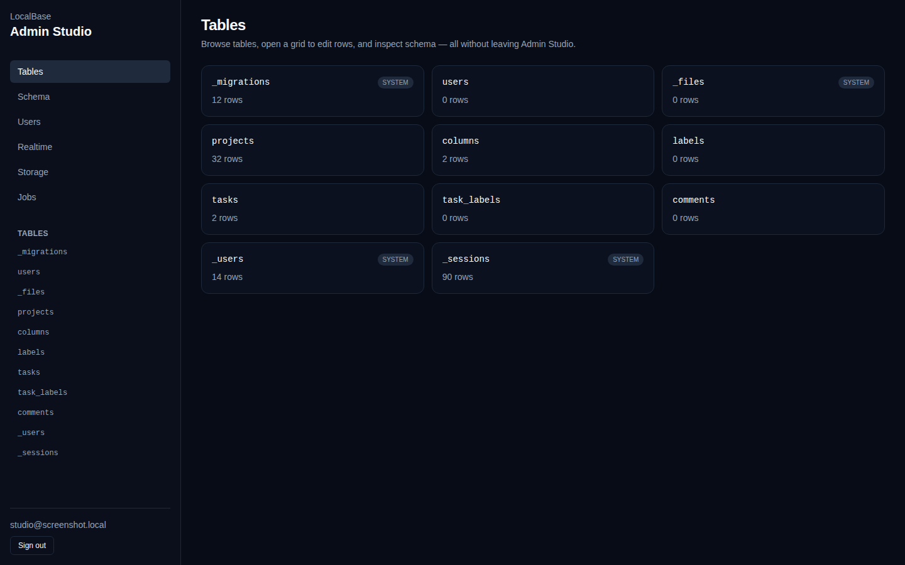

# Admin Studio

Built-in dashboard at **`http://127.0.0.1:5180/admin/`** (trailing slash). Served by `@localbase/core` from the same process as the API — `localbase studio` is enough.



```bash
npx @localbase/cli studio
# or: npx @localbase/cli dev   then open /admin/
```

---

## What you can do

- **Tables** — sidebar with row counts; sortable, filterable grid
- **Inline edit** — double-click a cell, Enter to save (fires realtime)
- **Add / delete rows**
- **Schema** — columns, types, PKs, FKs, indexes
- **Users** — when auth is on: list, create, reset password, promote/demote
- **Admin requests** — owner approves/rejects (after an owner exists)
- **Storage** — list and delete files
- **Jobs** — inspect schedule and run history; trigger a run

System tables are visible (read-only in the generic grid). Mutations go through typed APIs so password hashes and roles stay consistent. `_admin_requests` is hidden from the generic table list and only available via the approval UI.

Virtual tables (e.g. FTS5) are read-only.

The Realtime inspector view is a stub; subscriptions still work from the SDK.

---

## Auth gating

| Mode | Admin API |
| --- | --- |
| `auth.enabled` | Every `/_api/admin/*` call needs a JWT whose **live** `_users.role` is `admin` or `owner`. Demotion takes effect on the next request, even if the access token is still valid. |
| Auth off | Ungated. CLI binds loopback only, unless `--admin-unsafe-public`. |

First Studio sign-up becomes the owner. After that, signed-out Studio collects admin-account requests instead of minting another owner. Details: [AUTH](./AUTH.md#roles-and-first-owner).

---

## Admin JSON API

Used by the SPA. Not a public app API. When auth is on, send `Authorization: Bearer`.

| Method | Path |
| --- | --- |
| `GET` | `/_api/admin/schema` |
| `GET` | `/_api/admin/tables` |
| `GET` | `/_api/admin/tables/:t/rows` |
| `POST` | `/_api/admin/tables/:t/rows` |
| `PATCH` | `/_api/admin/tables/:t/rows/:id` |
| `DELETE` | `/_api/admin/tables/:t/rows/:id` |
| `GET` | `/_api/admin/users` |
| `POST` | `/_api/admin/users` |
| `POST` | `/_api/admin/users/:id/reset-password` |
| `PATCH` | `/_api/admin/users/:id/role` |
| `GET` | `/_api/admin/admin-requests` |
| `POST` | `/_api/admin/admin-requests/:id/approve` |
| `DELETE` | `/_api/admin/admin-requests/:id` |
| `GET` | `/_api/admin/jobs` |
| `GET` | `/_api/admin/jobs/:name/runs` |
| `POST` | `/_api/admin/jobs/:name/run` |

Writes to system tables through the generic row routes return **403**.
